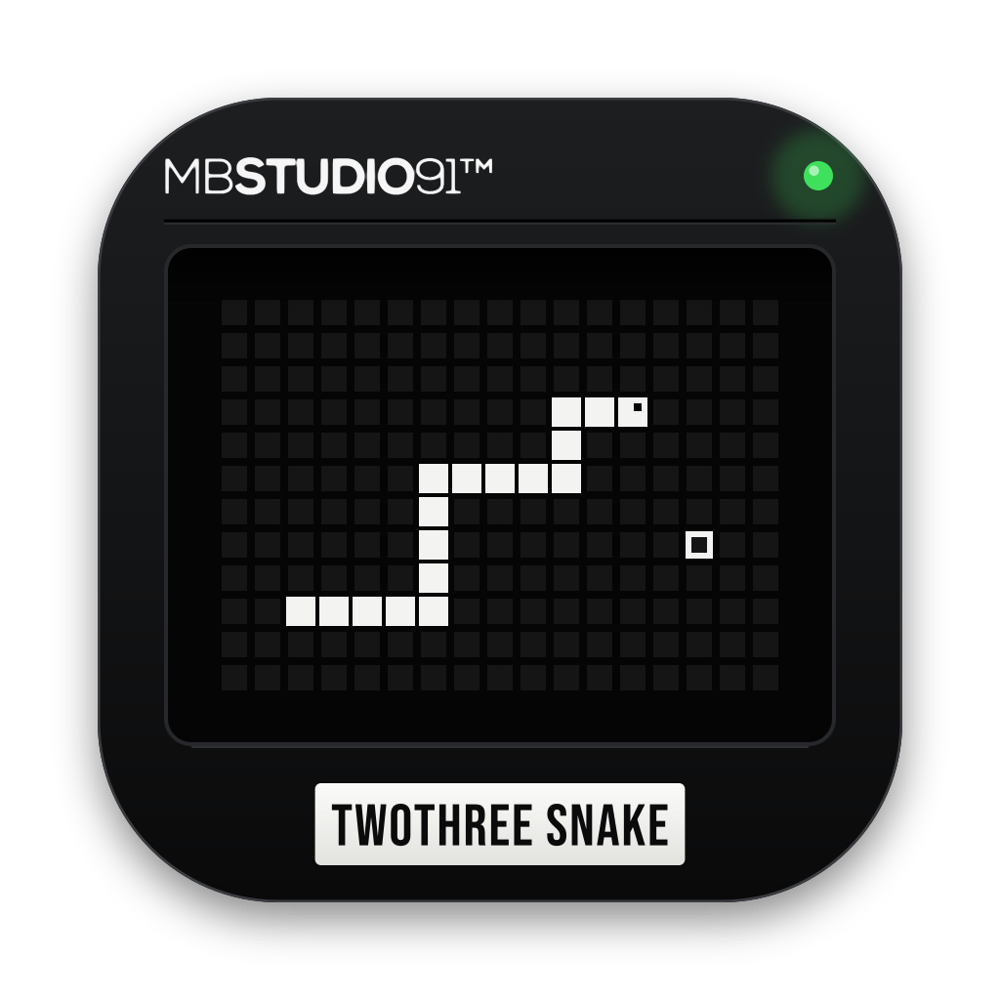

# TwoThree Snake

Il serpente dei vecchi telefoni che suona techno: ogni direzione è un modo ritmico (Berlin, Tresillo, Dub, Due·Tre) e ogni curva rigenera il pattern. Il display a LED prende il colore del modo e pulsa sulla cassa.

Fa parte delle app di MBStudio91 (Piedmont Electronic Sound), con la grafica hardware MBStudio91: telaio nero, serigrafia bianca, LED.

## Provala

Scarica lo zip dall'ultima versione nella pagina **Releases** (a destra in questa pagina), estrailo e apri `index.html` con doppio clic in Chrome, Safari, Edge o Firefox. Funziona anche senza internet: tutto il suono è sintetizzato nel browser.

## Come si usa

- Premi 5 (o tocca lo schermo) per partire; 2, 4, 6, 8 o le frecce per girare.
- Ogni boccone aggiunge 1 BPM e apre il filtro dell'acid; ai punti indicati entrano nuove tracce.
- Il sequencer sotto mostra il pattern che sta suonando: puoi cambiarlo a mano finché il serpente non curva.
- Voce e Hit accettano i tuoi campioni (WAV, MP3, AIFF, M4A); restano nel tuo browser.

## File

- `index.html`: l'app completa.
- `fonts/` e `fonts-apps.css`: font usati dall'app.
- `icons/`: icona dell'app per Mac (.icns), Windows (.ico), web e iPhone.

## Crediti

- Stile MBStudio91: font Bebas Neue (© Dharma Type) e Antonio (© Vernon Adams), SIL Open Font License 1.1, incorporati nella pagina.
- Pixel del display e codice: font Silkscreen, Fragment Mono e gli altri nella cartella `fonts/`, tutti SIL Open Font License 1.1 (licenze accanto ai file).
- Codice e grafica © MBStudio91, tutti i diritti riservati.
